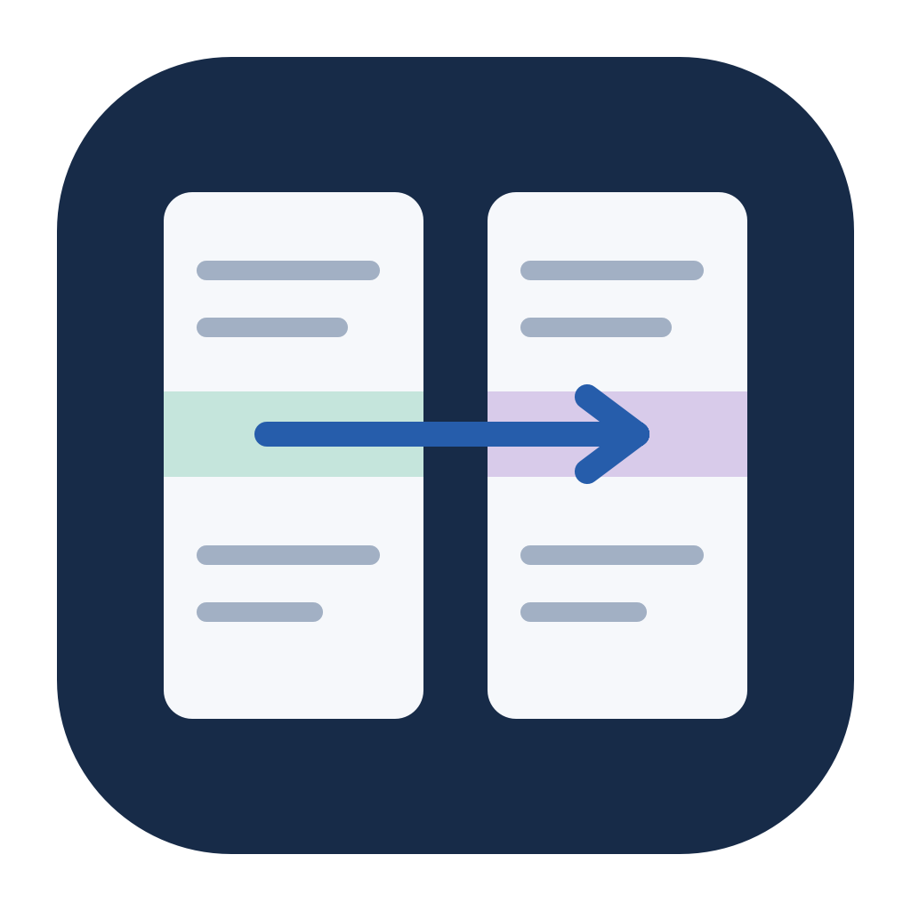
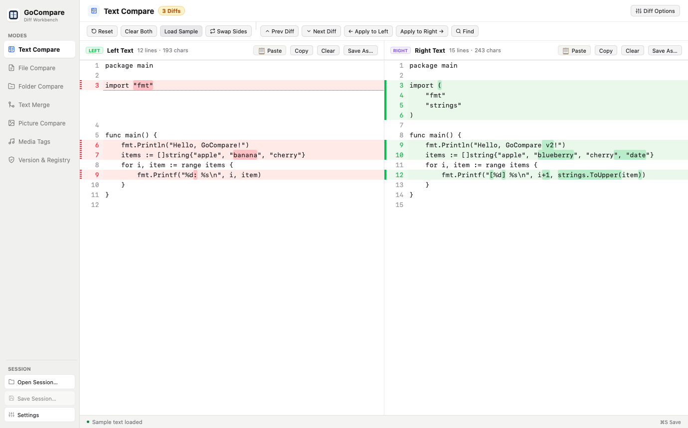
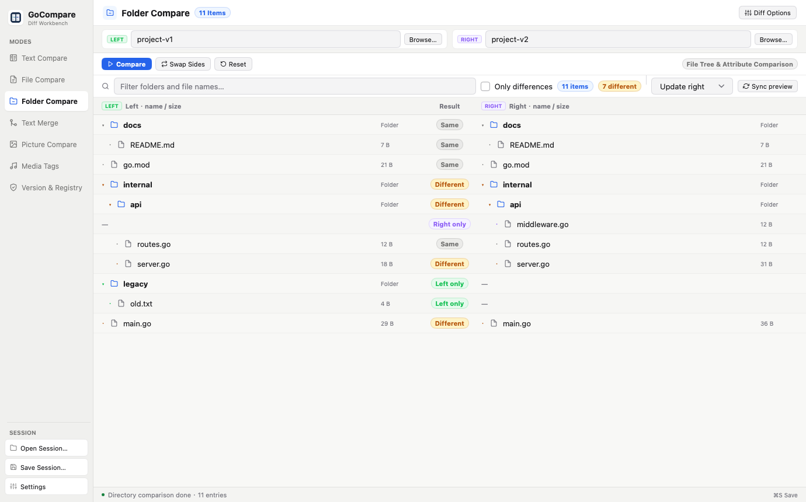
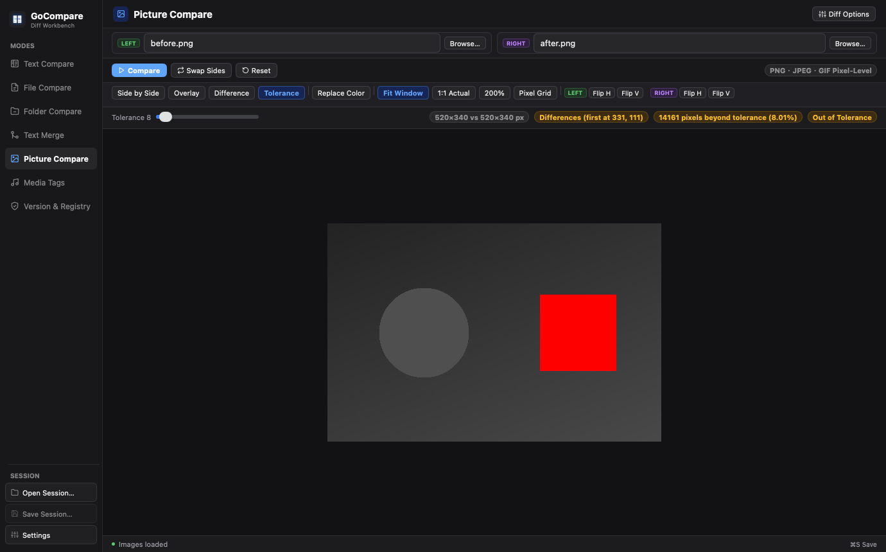

<div align="center">



# GoCompare

**A native, cross-platform file and folder comparison tool written in Go.**

Compare text, folders, images and binary metadata, merge three-way, and sync directories safely — in a fast native window or from the command line.

[](https://github.com/jhzhang09/gocompare/actions/workflows/check.yml)
[](https://github.com/jhzhang09/gocompare/releases)
[](go.mod)
[](LICENSE)


**English** · [简体中文](README.zh-CN.md)

</div>



## Why GoCompare

- **Native, not a web view.** Built with [MyGo](https://github.com/egoist/mygo): pure Go, no Electron, WebView, Node.js or cgo. One small binary per platform, cross-compiled from any machine.
- **Safe by default.** Saves never overwrite a file that changed on disk, folder sync always previews first, backs up before overwriting or deleting, and rolls back on failure.
- **GUI and CLI share one core.** Everything you can do in the window you can script, with stable exit codes for CI and Git.

> [!NOTE]
> GoCompare is in early development (pre-1.0). Core comparison, merge and sync paths are well tested, but some features are still partial — see the [feature matrix](docs/feature-parity.md). Feedback and bug reports are very welcome.

## Features

| Mode | What it does |
|---|---|
| **Text compare** | Paste or type into two panes and see differences instantly, with word-level highlights. Swap, copy, clear and save either side. |
| **File compare** | Side-by-side diff with **both sides editable**, undo/redo, find & replace, manual alignment anchors, ignore whitespace / blank lines. Detects UTF-8, UTF-16 (BOM) and GBK and preserves encoding, BOM and line endings on save. |
| **Folder compare** | Recursive tree with collapse, filter and "only differences". Optionally compares permissions and modification times and follows symlinks safely. |
| **Folder sync** | Update left/right/both or mirror. Always previews a plan; executes with backups, a journal, automatic rollback on failure and one-click undo. |
| **Three-way merge** | Base / left / right aligned columns, take left / right / both / base per conflict, edit the output freely. Also works as a Git `mergetool`. |
| **Picture compare** | PNG, JPEG, GIF: side by side, overlay, pixel difference, a 0–255 tolerance map that marks real changes in red, background color replacement and per-side flipping. |
| **Media tags** | Compares ID3v2.3 / v2.4 title, artist and album without decoding audio. |
| **Version & registry** | Compares PE `FileVersion` resources and Windows `.reg` exports (UTF-16 or UTF-8) without touching the live registry. |
| **Sessions & i18n** | Save and reopen comparison sessions. UI in English, 简体中文 and 繁體中文; light, dark or system theme. |

<table>
  <tr>
    <td></td>
    <td></td>
  </tr>
  <tr>
    <td align="center">Folder compare</td>
    <td align="center">Picture compare (tolerance map)</td>
  </tr>
</table>

## Installation

### Homebrew (macOS)

```bash
# Desktop app (GUI)
brew install --cask --no-quarantine jhzhang09/tap/gocompare

# Command line (CLI)
brew install jhzhang09/tap/gocompare-cli
```

### Manual download

Download the latest build from the [**Releases**](https://github.com/jhzhang09/gocompare/releases) page.

| Platform | Desktop app | Command line |
|---|---|---|
| macOS 12+ (Apple Silicon & Intel) | `gocompare-<version>.dmg` | `gocompare-cli_<version>_darwin_<arch>.tar.gz` |
| Windows 10 / 11 | `gocompare-setup-<version>-<arch>.exe` or the portable `.zip` | `gocompare-cli_<version>_windows_<arch>.zip` |
| Linux (GTK 3) | `.deb` or `.tar.gz` | `gocompare-cli_<version>_linux_<arch>.tar.gz` |

Every release ships `SHA256SUMS.txt` and a [build provenance attestation](https://docs.github.com/actions/security-for-github-actions/using-artifact-attestations) you can check with `gh attestation verify <file> --repo jhzhang09/gocompare`.

<details>
<summary><b>macOS: "GoCompare can't be opened"</b></summary>

Release builds are ad-hoc signed but not notarized yet. Right-click **GoCompare.app → Open** the first time, or run:

```bash
xattr -dr com.apple.quarantine /Applications/GoCompare.app
```
</details>

<details>
<summary><b>Windows: SmartScreen warning</b></summary>

The binaries are not code-signed yet. Choose **More info → Run anyway**.
</details>

<details>
<summary><b>Linux</b></summary>

```bash
sudo apt install ./gocompare_<version>_amd64.deb
# or, without installing:
tar xzf gocompare-<version>-linux-amd64.tar.gz && ./gocompare
```

GTK 3 is required; it is present on most desktop distributions.
</details>

### Build from source

Requires Go 1.27.3 or newer. All dependencies are vendored, so no network access is needed.

```bash
git clone https://github.com/jhzhang09/gocompare.git
cd gocompare
go run ./cmd/gocompare                       # run the desktop app
go build -o build/ ./cmd/gocompare-cli        # build the CLI
go tool mygo build                            # package the app for this platform (.app/.dmg on macOS)
```

## Usage

### Desktop app

```bash
gocompare                                    # start with the text compare workspace
gocompare left.txt right.txt                 # compare two files
gocompare --directories ./left ./right       # compare two folders
gocompare --version
```

On macOS the executable lives at `/Applications/GoCompare.app/Contents/MacOS/GoCompare`.

### Command line

`gocompare-cli` exits with **0** when inputs are equal (or a merge is clean), **1** when they differ (or conflicts remain) and **2** on errors.

```bash
gocompare-cli left.txt right.txt                                  # compare two files
gocompare-cli dir --filter '*.go' ./v1 ./v2                       # folder report as JSON
gocompare-cli preview mirror-right ./src ./dst                    # sync plan (read-only)
gocompare-cli sync --mode mirror-right --apply --backup-dir ~/gocompare-backup ./src ./dst
gocompare-cli restore ~/gocompare-backup/sync/journal.json        # undo a sync
gocompare-cli merge --base base.txt --output merged.txt left.txt right.txt
gocompare-cli picture before.png after.png
```

Sync modes: `update-right`, `update-left`, `update-both`, `mirror-right`, `mirror-left`. Run `gocompare-cli --help` for every command, including `hex`, `media`, `pe`, `reg`, `script`, `report` and `extend`.

### Git integration

```bash
git config --global diff.tool gocompare
git config --global difftool.gocompare.cmd 'gocompare "$LOCAL" "$REMOTE"'
git config --global merge.tool gocompare
git config --global mergetool.gocompare.cmd 'gocompare-cli mergetool --base "$BASE" --output "$MERGED" "$LOCAL" "$REMOTE"'
git config --global mergetool.gocompare.trustExitCode true
```

`mergetool` writes the merge result into `$MERGED` and exits with 1 while conflicts remain, so Git keeps the file marked as unresolved until you fix it.

## Safety guarantees

- **Saves are atomic and conflict-aware.** Files are written to a temporary file in the same folder and renamed into place only if the file on disk still matches what was loaded. "Save as" never overwrites an existing file.
- **Folder sync is plan → confirm → execute.** Every action records the size, SHA-256, mode and time it expects. Execution re-checks them, backs up files before overwriting or deleting, journals each step and rolls back completed steps on any error or cancellation.
- **Undo never destroys newer work.** Undoing a sync refuses to touch files that changed after the sync, and plans are refused when names collide only by letter case on case-insensitive file systems.

The full contract is in [docs/operations.md](docs/operations.md) (Chinese).

## Documentation

| Document | Contents |
|---|---|
| [Architecture](docs/architecture.md) | Module boundaries and data flow |
| [Feature matrix](docs/feature-parity.md) | What is complete, partial or planned |
| [Platform support](docs/platform-support.md) | Build targets and per-platform status |
| [Operations contract](docs/operations.md) | Save and sync safety guarantees |
| [Testing](docs/testing.md) | Automated and native regression tests |
| [MyGo patch](docs/mygo-patch.md) | How the vendored framework patch is maintained |
| [Releasing](docs/releasing.md) | How maintainers cut a release |

Most design documents are currently written in Chinese.

## Contributing

Contributions are welcome! Please read [CONTRIBUTING.md](CONTRIBUTING.md) and our [Code of Conduct](CODE_OF_CONDUCT.md). In short:

```bash
gofmt -l cmd internal tools     # must print nothing
go vet ./...
CGO_ENABLED=0 go test ./...
go tool mygo vet .
```

To report a security issue, please follow [SECURITY.md](SECURITY.md) instead of opening a public issue.

## Acknowledgements

- [MyGo](https://github.com/egoist/mygo) by [@egoist](https://github.com/egoist) — the native Go desktop UI framework GoCompare is built on.
- [golang.org/x/text](https://pkg.go.dev/golang.org/x/text) and [golang.org/x/image](https://pkg.go.dev/golang.org/x/image).

## License

[MIT](LICENSE) © GoCompare Contributors
