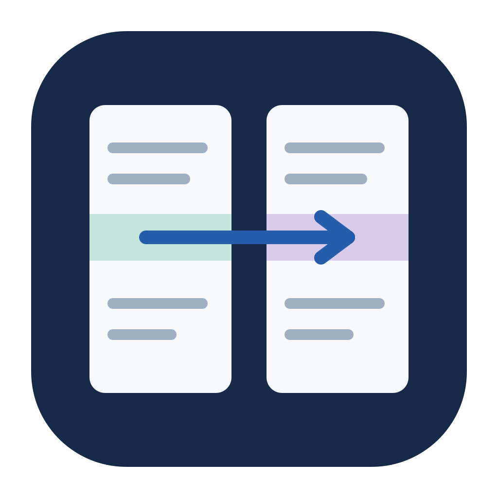
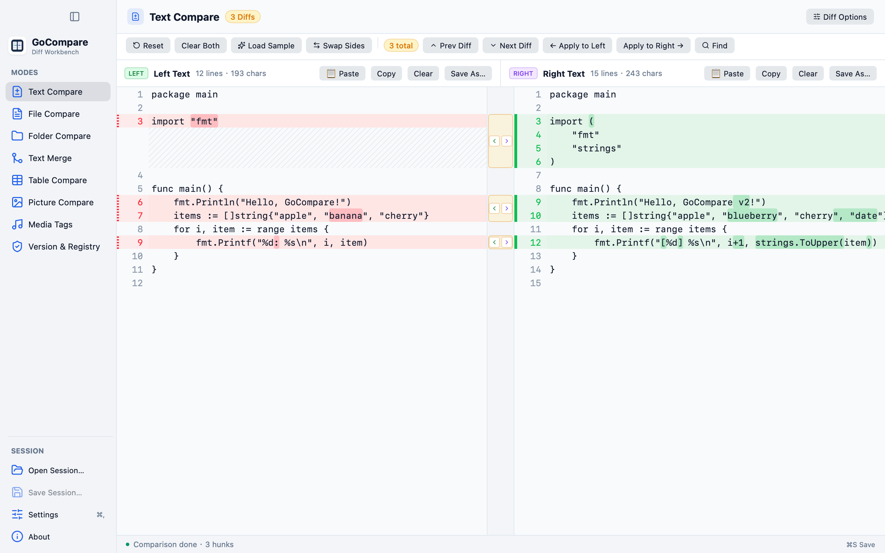
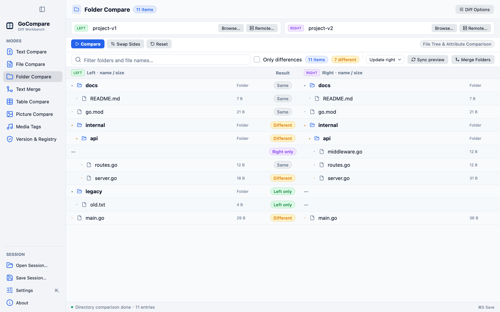
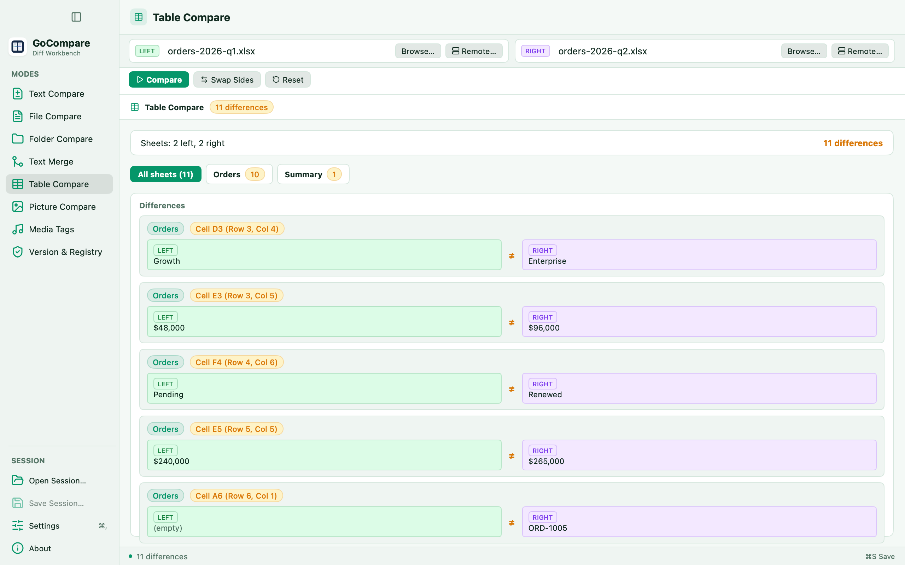
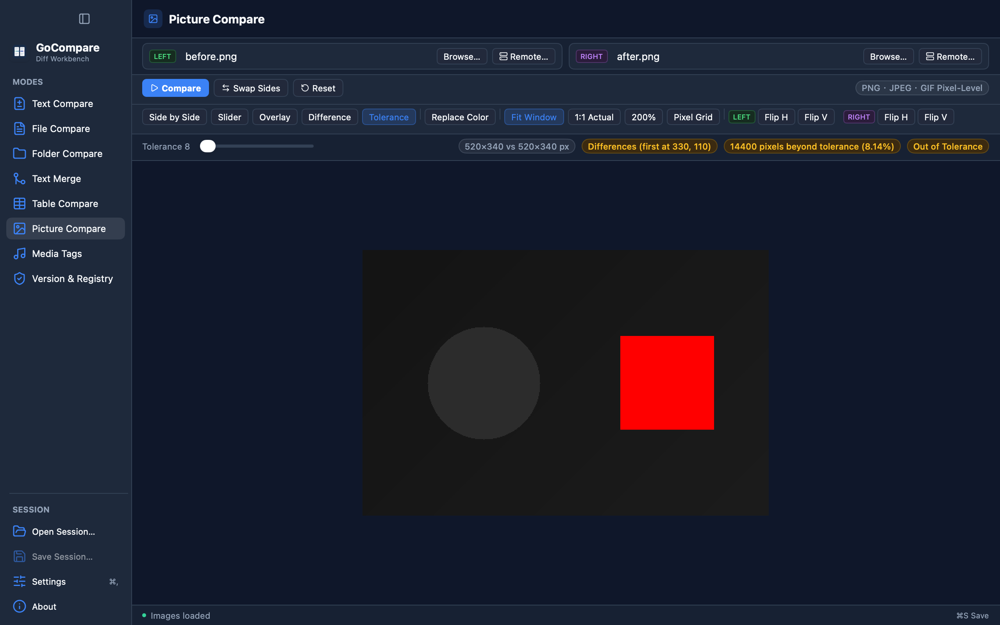
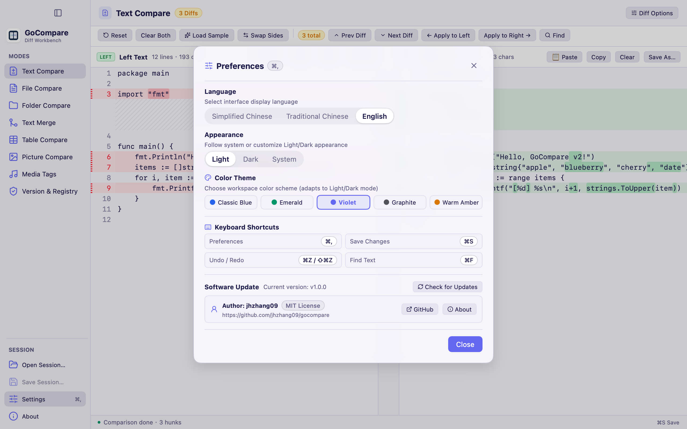

<div align="center">



# GoCompare

**A fast, native, cross-platform file and folder comparison workbench written in Go.**

Compare text, source files, directories, spreadsheets, images, audio tags, executables, and registry exports — locally or directly over SFTP, SMB, FTP/FTPS, and WebDAV — merge three-way conflicts, and synchronize folders safely from a native desktop window or the command line.

[](https://github.com/jhzhang09/gocompare/actions/workflows/check.yml)
[](https://github.com/jhzhang09/gocompare/releases)
[](go.mod)
[](LICENSE)

[](https://awesomemygo.dev/apps/gocompare)

**English** · [简体中文](README.zh-CN.md)

</div>



## Why GoCompare

- **True native desktop UI, zero web view.** Built with [MyGo](https://github.com/egoist/mygo) and [Onevra](https://github.com/oneo-me/onevra): pure Go, no Electron, no WebView, no Node.js, and no runtime dependencies. Launches instantly as a single lightweight binary per platform.
- **Refined workbench experience.** Powered by Onevra's responsive `sidebar.Shell` with macOS traffic-light titlebar integration, crisp Lucide vector icons, 5 curated color themes (**Classic Blue**, **Emerald**, **Violet**, **Graphite**, **Warm Amber**) across Light/Dark/System modes, and full keyboard shortcut navigation.
- **Safe by default.** File saves are atomic and conflict-aware, refusing to overwrite external changes on disk or remote servers. Folder synchronization follows a strict **Plan → Confirm → Execute** pipeline with automatic backups, journals, rollback on failure, and one-click undo.
- **Local and remote in one workflow.** Browse and compare files or entire directory trees over **SFTP, SMB, FTP/FTPS, and WebDAV** right inside the app, with SSH config import, host-key fingerprint verification, and memory-only credential handling.
- **One core for GUI and CLI.** Every comparison, merge, and sync engine powers both the desktop workbench (`gocompare`) and the scriptable command-line tool (`gocompare-cli`) with deterministic exit codes for Git and CI pipelines.

## Screenshots

<table>
  <tr>
    <td width="50%"></td>
    <td width="50%"></td>
  </tr>
  <tr>
    <td align="center"><b>Folder Compare</b> — Recursive tree, attribute filter & safe sync preview</td>
    <td align="center"><b>Table Compare</b> — Multi-sheet Excel/CSV diff with cell cards (Emerald theme)</td>
  </tr>
  <tr>
    <td width="50%"></td>
    <td width="50%"></td>
  </tr>
  <tr>
    <td align="center"><b>Picture Compare</b> — Interactive split slider & pixel tolerance map (Dark mode)</td>
    <td align="center"><b>Preferences & Themes</b> — 5 color schemes, shortcuts & updater (Violet theme)</td>
  </tr>
</table>

## Features

| Mode | Capabilities |
|---|---|
| **Text Compare** | Instant scratchpad diff with word-level inline highlights, a center diff gutter for click-to-focus and inline `←` / `→` hunk merging, visual applied-change badges (`← ✓` / `✓ →`), and on-demand per-side & cross-side undo/redo/restore. Swap, copy, clear, or save either side. |
| **File Compare** | Side-by-side editor with **both sides editable**, aligned center diff bands, inline `←` / `→` hunk apply and `← ✓` / `✓ →` applied markers, line & gutter highlights for applied edits, per-pane & global undo/redo and one-click baseline restore, find & replace, manual alignment anchors, and whitespace/blank-line filters. Automatically detects UTF-8, UTF-16 (BOM), and GBK while preserving encoding, BOM, and line endings on save. Extracts read-only text from `.docx` and `.pdf` files. |
| **Folder Compare** | Recursive tree comparison with collapsible folders, glob filtering, and "Only differences" toggle. Optionally compares Unix permissions and modification timestamps, and safely records or follows symlinks. Double-click any file row to inspect its content diff. |
| **Folder Sync & Merge** | Update left, update right, update both, or mirror. Always generates a read-only preview plan first; executes with pre-change backups, a step journal, automatic rollback on error, and one-click undo. Two-way and three-way folder merge resolves file-level conflicts. |
| **Three-Way Text Merge** | Base / Left / Right aligned columns with per-conflict resolution (`Take Left`, `Take Right`, `Take Both`, `Take Base`), live output editor, independent merge window launcher, and full Git `mergetool` integration. |
| **Table Compare** | Cell-by-cell comparison for CSV, TSV, Excel (`.xlsx`), and HTML tables. Multi-sheet workbooks align sheets by name with interactive sheet tabs, Excel `A1`/`B2` coordinates, side-by-side cell diff cards, and 50-item pagination. CLI adds composite key columns, column mapping, and numeric tolerance. |
| **Picture Compare** | Pixel-level comparison for PNG, JPEG, and GIF: **Side by Side**, interactive **Slider** split curtain (`ImageCompare`), **Overlay**, **Difference**, **0–255 Tolerance** map (highlighting out-of-tolerance pixels in red), **Replace Color**, zoom presets (`Fit`, `1:1`, `200%`, `Pixel Grid`), and independent horizontal/vertical flipping per side. |
| **Media Tags** | Inspects and compares audio metadata across MP3 (`ID3v2.3` / `ID3v2.4` / `ID3v1`), FLAC (`Vorbis Comment` & cover art), M4A/MP4 (`ilst`), WAV (`LIST/INFO` & ID3), and OGG/Opus without decoding audio streams. |
| **Version & Registry** | Compares Windows PE executables/installers (`RT_VERSION`, architecture, `ProductName`, `CompanyName`, SHA-256 fallback) and Windows `.reg` exports (`Windows Registry Editor Version 5.00` & `REGEDIT4` in UTF-16/UTF-8) with `Left only` / `Right only` / `Modified` classification. |
| **Remote & Drag-and-Drop** | Every mode includes a **Remote…** browser for SFTP, SMB, FTP/FTPS, and WebDAV, plus drag-and-drop auto-fill onto path capsules or the empty workspace card. |

## Themes, Appearance & Shortcuts

GoCompare provides a customizable native workspace accessible via **Settings** (`⌘,` on macOS, `Ctrl+,` on Windows/Linux):

- **5 Color Themes**: **Classic Blue**, **Emerald**, **Violet**, **Graphite**, and **Warm Amber**.
- **Appearance Modes**: **Light**, **Dark**, or **System** (automatically follows OS appearance changes in real time).
- **Interface Languages**: **English**, **简体中文**, and **繁體中文**.

| Action | macOS | Windows / Linux |
|---|---|---|
| Open / Close Preferences | `⌘,` | `Ctrl+,` |
| Save Active Side / Merge Output | `⌘S` | `Ctrl+S` |
| Undo | `⌘Z` | `Ctrl+Z` |
| Redo | `⇧⌘Z` | `Ctrl+Shift+Z` |
| Find in Diff Editor | `⌘F` | `Ctrl+F` |

## Remote Files & Drag-and-Drop

All comparison modes (**File Compare**, **Folder Compare**, **Text Merge**, **Table Compare**, **Picture Compare**, **Media Tags**, and **Version & Registry**) can connect directly to remote servers or load dropped files. Either side — or both — can be remote.

### Remote connections

1. Click **Remote…** next to the left or right path in any mode.
2. Choose the protocol and enter the host and user name. For SFTP you can also import a host directly from `~/.ssh/config`.
3. Enter a password, or choose a private key (fill in its passphrase if encrypted). Leave both empty to use `ssh-agent` or your default `~/.ssh/id_*` keys.
4. Click **Connect**, browse the remote directory tree, and pick a file (**Open**) or folder (**Choose this folder**). If the other side is already set, comparison begins immediately.

| Protocol | Interactive Browser | Authentication |
|---|---|---|
| SFTP (SSH) | Yes | Password, private key (+ passphrase), `ssh-agent`, `~/.ssh/id_*` |
| SMB (Windows Share / NAS) | Yes (including share enumeration) | Username, password, optional domain (NTLMv2) |
| FTP / FTPS | Yes (servers supporting `MLSD`) | Username and password |
| WebDAV / WebDAV over HTTPS | Yes | Username and password (HTTP Basic) |
| S3, Dropbox, OneDrive, SVN | Direct URL input in path bar | Credentials in URL |

- **Host keys are verified.** First-time SFTP connections display the server fingerprint and record it in `~/.ssh/known_hosts` only after explicit confirmation; mismatched host keys are rejected.
- **Secrets stay in memory.** Passwords and private-key passphrases are never written to disk, session files, or settings.

### Drag-and-drop auto-fill

- **Single item**: Drop a file or folder onto the left or right path capsule to populate that side; if the opposite side is already filled, comparison starts automatically.
- **Two items at once**: Select two files or folders in Finder / Explorer and drop them onto either path capsule or the empty workspace card to fill both sides and compare immediately.
- **Smart mode switching**: Dropping a directory into File Compare automatically switches to Folder Compare.

## Installation

### Homebrew

```bash
# Desktop app (macOS) — installs GoCompare.app, links `gocompare`, and clears quarantine automatically
brew install --cask jhzhang09/tap/gocompare

# Command-line tool (macOS and Linux) — installs `gocompare-cli`
brew install jhzhang09/tap/gocompare-cli
```

### Manual download

Download the latest release from [**GitHub Releases**](https://github.com/jhzhang09/gocompare/releases).

| Platform | Desktop App | Command Line |
|---|---|---|
| macOS 12+ (Apple Silicon & Intel) | `gocompare-<version>.dmg` | `gocompare-cli_<version>_darwin_<arch>.tar.gz` |
| Windows 10 / 11 | `gocompare-setup-<version>-<arch>.exe` or portable `.zip` | `gocompare-cli_<version>_windows_<arch>.zip` |
| Linux (GTK 3) | `.deb` or `.tar.gz` | `gocompare-cli_<version>_linux_<arch>.tar.gz` |

Every release includes `SHA256SUMS.txt` and a [GitHub build provenance attestation](https://docs.github.com/actions/security-for-github-actions/using-artifact-attestations) verifiable via:

```bash
gh attestation verify <file> --repo jhzhang09/gocompare
```

<a id="macos-gatekeeper"></a>
<details>
<summary><b>macOS (manual <code>.dmg</code> download): "GoCompare can't be opened"</b></summary>

Release builds are ad-hoc signed (Homebrew Cask clears quarantine automatically during installation). If you downloaded the `.dmg` manually in a browser, clear the quarantine attribute once with:

```bash
xattr -dr com.apple.quarantine /Applications/GoCompare.app
```

or attempt to open the app, then go to **System Settings → Privacy & Security → Open Anyway**.
</details>

<details>
<summary><b>Windows: SmartScreen warning</b></summary>

Choose **More info → Run anyway**.
</details>

<details>
<summary><b>Linux</b></summary>

```bash
sudo apt install ./gocompare_<version>_amd64.deb
# or run from the archive without installing:
tar xzf gocompare-<version>-linux-amd64.tar.gz && ./gocompare
```

Requires GTK 3 (pre-installed on most desktop Linux distributions).
</details>

### Build from source

Requires Go 1.27.3 or newer. All dependencies are vendored in `vendor/`, so builds work completely offline.

```bash
git clone https://github.com/jhzhang09/gocompare.git
cd gocompare
go run ./cmd/gocompare                       # run the desktop app
go build -o build/ ./cmd/gocompare-cli        # build the CLI binary
go tool mygo build                            # package native desktop app (.app/.dmg on macOS)
```

## Usage

### Desktop app

```bash
gocompare                                    # launch in Text Compare scratchpad mode
gocompare left.txt right.txt                 # compare two files directly
gocompare --directories ./left ./right       # compare two directories directly
gocompare --version
```

### Command line (`gocompare-cli`)

`gocompare-cli` exits with **0** when inputs are identical (or a merge completes cleanly), **1** when differences or unresolved conflicts remain, and **2** on error.

```bash
gocompare-cli left.txt right.txt                                  # compare two files
gocompare-cli dir --filter '*.go' ./v1 ./v2                       # directory diff report as JSON
gocompare-cli preview mirror-right ./src ./dst                    # preview sync plan (read-only)
gocompare-cli sync --mode mirror-right --apply --backup-dir ~/gocompare-backup ./src ./dst
gocompare-cli restore ~/gocompare-backup/sync/journal.json        # roll back a completed sync
gocompare-cli merge --base base.txt --output merged.txt left.txt right.txt
gocompare-cli picture before.png after.png
```

Supported sync modes: `update-right`, `update-left`, `update-both`, `mirror-right`, `mirror-left`.

Additional CLI subcommands for remote endpoints, spreadsheets, archives, and snapshots:

```bash
gocompare-cli remote compare sftp://deploy@web1/etc/app.conf sftp://deploy@web2/etc/app.conf
gocompare-cli remote read "smb://CORP;bob@nas/docs/report.txt" > report.txt
gocompare-cli table --keys 0 --tolerance 0.01 before.csv after.xlsx
gocompare-cli archive compare release-1.zip release-2.zip
gocompare-cli snapshot create ./build build.snapshot        # compare later via: snapshot compare a.snapshot b.snapshot
gocompare-cli dirmerge --base ./base --output ./merged ./left ./right
```

Run `gocompare-cli --help` for the complete list of subcommands, including `hex`, `media`, `pe`, `reg`, `doctext`, `acl`, `check-update`, `script`, `report`, and `extend`.

### Git integration

```bash
git config --global diff.tool gocompare
git config --global difftool.gocompare.cmd 'gocompare "$LOCAL" "$REMOTE"'
git config --global merge.tool gocompare
git config --global mergetool.gocompare.cmd 'gocompare-cli mergetool --base "$BASE" --output "$MERGED" "$LOCAL" "$REMOTE"'
git config --global mergetool.gocompare.trustExitCode true
```

## Safety Guarantees

- **Atomic, conflict-checked saves.** Saving writes to a sibling temporary file and renames into place only after verifying the target file on disk (or remote server) has not changed since it was loaded. "Save As" never overwrites an existing file.
- **Plan → Confirm → Execute folder sync.** Every planned action records expected size, SHA-256 digest, permissions, and modification time. Execution re-verifies each file, backs up overwritten/deleted items, writes a journal entry per step, and automatically rolls back completed steps on error or cancellation.
- **Non-destructive sync undo.** Undoing a sync refuses to touch any file modified after the sync completed, and case-only filename collisions on case-insensitive filesystems are rejected during planning.

See [docs/operations.md](docs/operations.md) for the full safety specification.

## Documentation

| Document | Description |
|---|---|
| [Architecture](docs/architecture.md) | Package boundaries and data flow |
| [Feature Matrix](docs/feature-parity.md) | Detailed capability matrix across GUI and CLI |
| [Platform Support](docs/platform-support.md) | Supported OS targets and packaging formats |
| [Operations Contract](docs/operations.md) | Atomic save, backup, journal, and rollback guarantees |
| [Testing Guide](docs/testing.md) | Unit, headless UI, and regression test suites |
| [MyGo Patch](docs/mygo-patch.md) | Vendored framework patch maintenance |
| [Releasing](docs/releasing.md) | Release workflow and version tagging guide |

## Contributing

Contributions, bug reports, and feature requests are welcome! Please review [CONTRIBUTING.md](CONTRIBUTING.md) and our [Code of Conduct](CODE_OF_CONDUCT.md). Before submitting a pull request, verify all checks pass locally:

```bash
gofmt -l cmd internal tools     # must produce no output
go vet ./...
CGO_ENABLED=0 go test ./...
go tool mygo vet .
```

To report a security vulnerability, please follow [SECURITY.md](SECURITY.md).

## Acknowledgements

Special thanks to the open-source projects and authors that make GoCompare possible:

- **[MyGo](https://github.com/egoist/mygo)** by [@egoist](https://github.com/egoist) — the pure-Go native desktop UI framework that renders GoCompare's native windows, text editors, and diff views across macOS, Windows, and Linux without web views.
- **[Onevra](https://github.com/oneo-me/onevra)** by [@oneo-me](https://github.com/oneo-me) — the native component library, responsive sidebar shell (`shells/sidebar`), interactive image comparison slider (`ImageCompare`), and Lucide vector icon system powering GoCompare's modern workbench interface.
- **[golang.org/x/text](https://pkg.go.dev/golang.org/x/text)**, **[golang.org/x/image](https://pkg.go.dev/golang.org/x/image)**, **[golang.org/x/net](https://pkg.go.dev/golang.org/x/net)**, and **[golang.org/x/crypto](https://pkg.go.dev/golang.org/x/crypto)** from the Go project.
- **[pkg/sftp](https://github.com/pkg/sftp)** and **[go-smb2](https://github.com/hirochachacha/go-smb2)** for SFTP and SMBv2/v3 protocol support.

## Author & License

Created and maintained by **[jhzhang09](https://github.com/jhzhang09)** ([github.com/jhzhang09/gocompare](https://github.com/jhzhang09/gocompare)).

Licensed under the [MIT License](LICENSE).
