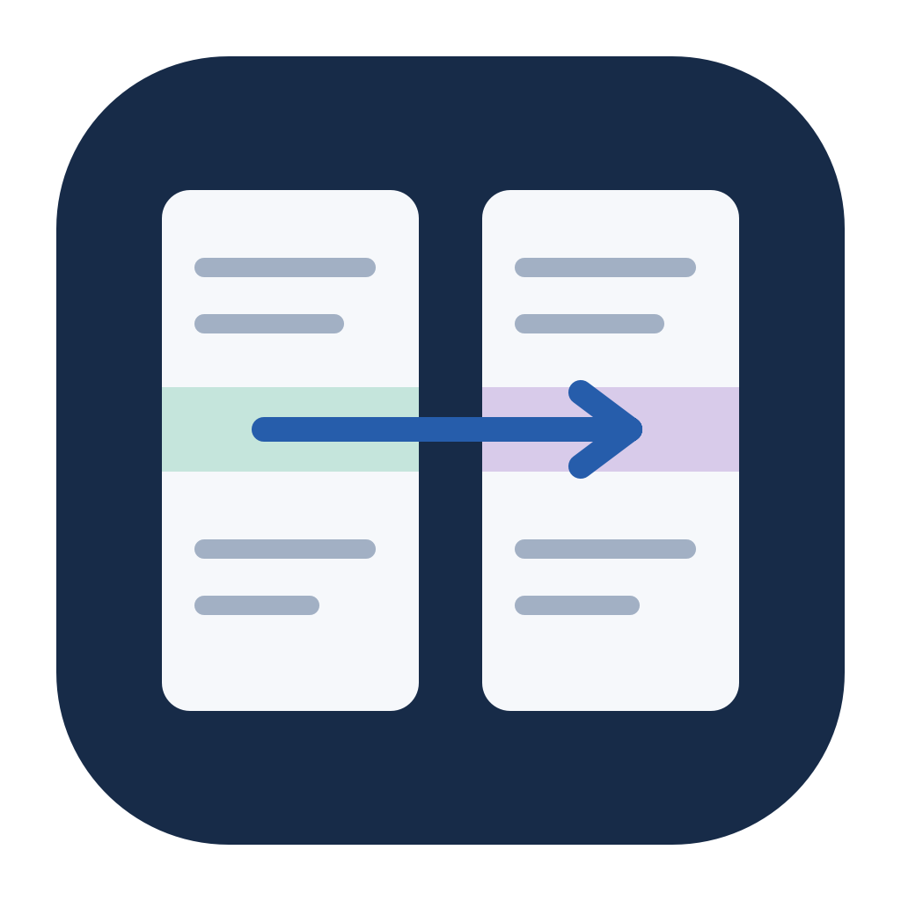
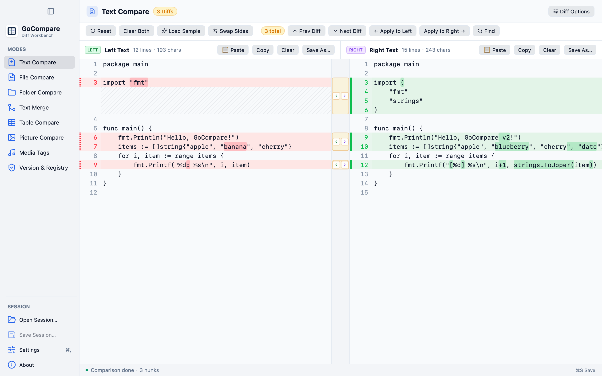
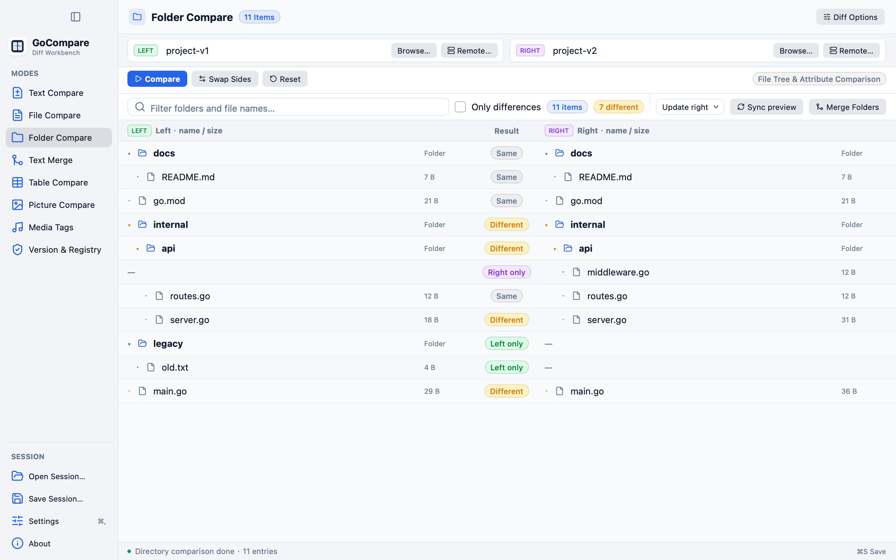
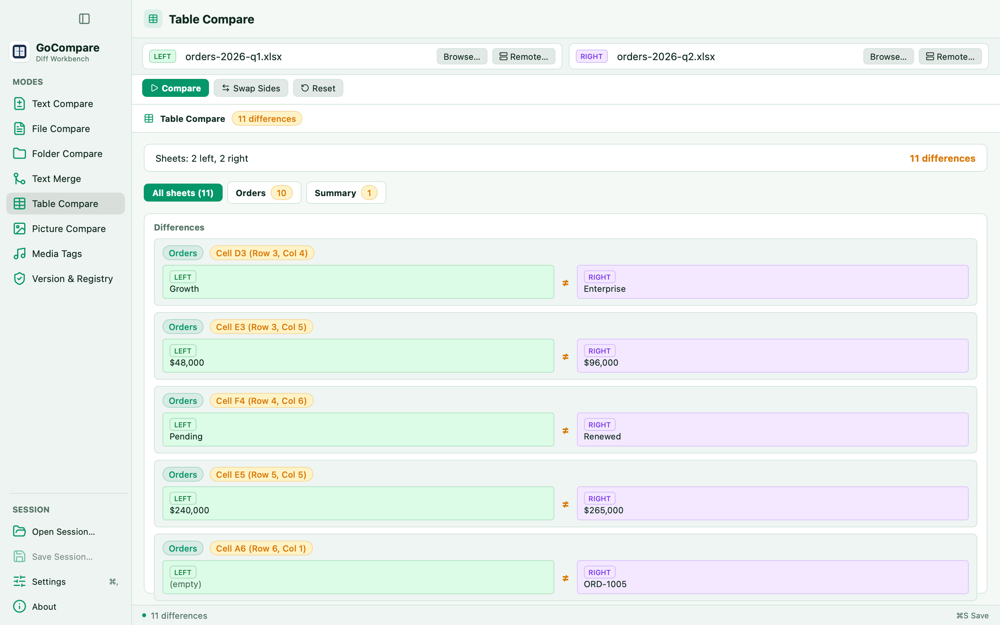
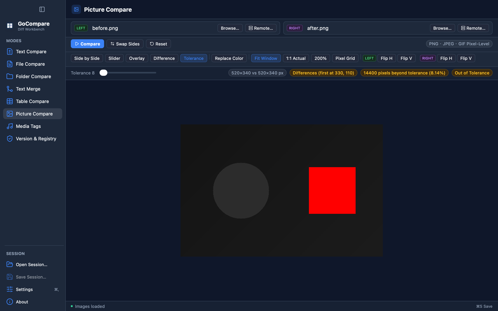
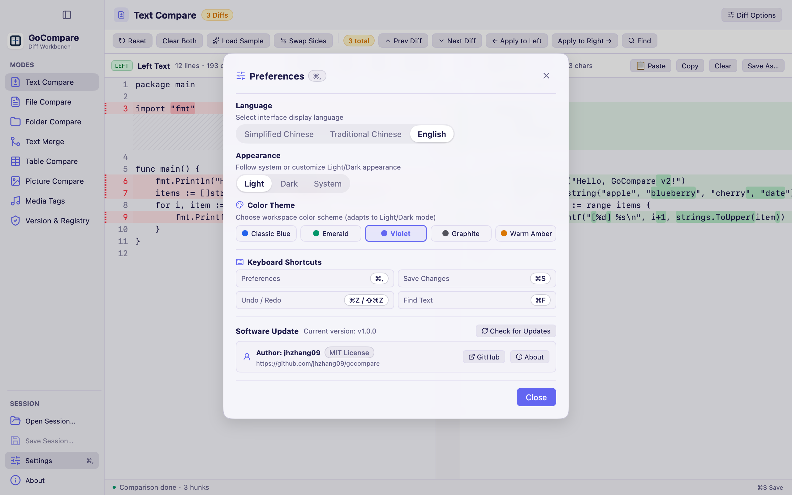

<div align="center">



# GoCompare

**基于 Go 构建的高性能原生跨平台文件与目录比较工作台。**

支持文本、源码文件、目录树、电子表格、图片、音频标签、PE 可执行文件与注册表导出的全方位对比——无论文件在本地还是 SFTP、SMB、FTP/FTPS、WebDAV 远程服务器上——并提供三方冲突合并与带备份回滚的目录同步能力，兼具流畅的原生桌面界面与可脚本化的命令行工具。

[](https://github.com/jhzhang09/gocompare/actions/workflows/check.yml)
[](https://github.com/jhzhang09/gocompare/releases)
[](go.mod)
[](LICENSE)


[English](README.md) · **简体中文**

</div>



## 为什么选择 GoCompare

- **纯正的原生桌面界面，彻底告别 WebView。** 基于 [MyGo](https://github.com/egoist/mygo) 与 [Onevra](https://github.com/oneo-me/onevra) 构建：纯 Go 实现，不含 Electron、WebView、Node.js，无任何外部运行时依赖。单文件体积小巧，冷启动毫秒级响应。
- **精致现代的工作台体验。** 采用 Onevra `sidebar.Shell` 原生侧边栏架构（完美适配 macOS 沉浸式红绿灯标题栏与侧边栏折叠）、Lucide 矢量图标系统、**5 款精选主题配色**（经典蓝、翡翠绿、暮光紫、石墨灰、暖珀金，均支持浅色／深色／跟随系统自动切换）以及完善的全局快捷键与系统菜单支持。
- **默认安全，零误删风险。** 文件保存采用同目录临时文件原子替换并校验磁盘冲突，绝不静默覆盖外部修改；目录同步严格遵循「**预览计划 → 确认 → 执行**」流程，覆盖或删除前自动备份、记录事务日志，中途出错自动回滚，并支持一键撤销。
- **本地与远程无缝统一。** 所有比较模式均可直接连接 **SFTP、SMB、FTP/FTPS、WebDAV** 服务器，在可视化对话框中浏览选定文件或目录，支持导入 `~/.ssh/config`、校验 SSH 主机指纹，且密码与私钥口令仅驻留内存。
- **GUI 与 CLI 共用同一核心引擎。** 桌面端能完成的每一项比较、合并与同步操作，均可通过 `gocompare-cli` 在终端、CI 流水线或 Git `difftool` / `mergetool` 中自动化执行。

## 界面预览

<table>
  <tr>
    <td width="50%"></td>
    <td width="50%"></td>
  </tr>
  <tr>
    <td align="center"><b>目录比较</b> — 递归文件树、差异过滤与安全同步预览</td>
    <td align="center"><b>表格比较</b> — 多工作表按名称对齐与单元格差异卡片（翡翠绿主题）</td>
  </tr>
  <tr>
    <td width="50%"></td>
    <td width="50%"></td>
  </tr>
  <tr>
    <td align="center"><b>图片比较</b> — 交互式滑块分屏与像素容差热力图（深色模式）</td>
    <td align="center"><b>偏好设置与主题</b> — 5 款配色方案、快捷键一览与版本检查（暮光紫主题）</td>
  </tr>
</table>

## 功能一览

| 模式 | 核心能力 |
|---|---|
| **文本比较** | 双栏草稿即时对比，支持词级行内高亮、中间差异连接列（点击聚焦、就地 `←`／`→` 单块合并、`← ✓`／`✓ →` 已应用徽章）、已修改行背景与行号槽标记，以及按需显现的单侧与跨侧全局撤销／重做／一键恢复初始状态。 |
| **文件比较** | 左右分栏对比且**两侧均可直接编辑保存**，内置中间差异操作列、已应用修改高亮、单栏及跨侧撤销／重做与一键恢复、查找替换、手动行对齐锚点、忽略空白与空行。自动识别 UTF-8、UTF-16（含 BOM）与 GBK 编码，保存时原样保留编码、BOM 与换行符；支持 Word（`.docx`）与 PDF 文本提取只读对比。 |
| **目录比较** | 递归树形视图，支持目录折叠、通配符过滤、仅显示差异项；可选比较文件权限与修改时间，支持安全记录或跟随符号链接。双击任意文件行即可直接跳转查看文件内容差异。 |
| **目录同步与合并** | 支持更新右侧、更新左侧、双向更新与镜像同步。始终先生成只读预览计划；执行前自动备份、记录步骤日志，失败自动回滚并支持一键撤销。内置两方／三方目录合并以解决文件级冲突。 |
| **三方文本合并** | 基准（Base）／左侧／右侧三栏对齐视图，每个冲突块可独立选择采用左侧、右侧、双方或基准，底部提供可自由编辑的合并输出区；支持从文件比较一键弹出独立合并窗口，或作为 Git `mergetool` 使用。 |
| **表格比较** | 支持 CSV、TSV、Excel（`.xlsx`）与 HTML 表格逐单元格对比。多工作表按表名智能对齐，提供工作表切换标签栏、标准 Excel 坐标（如 `Cell D3 (Row 3, Col 4)`）、左右对照卡片与分页浏览；命令行另支持复合主键列、列映射与数值容差。 |
| **图片比较** | 支持 PNG、JPEG、GIF 像素级对比：提供**并排显示**、**滑块对比**（`ImageCompare` 交互式拖拽分屏）、**叠加显示**、**差值模式**、**0–255 像素容差图**（超容差区域标红）、**替换颜色**、多级缩放与像素网格，以及左右独立水平／垂直翻转。 |
| **媒体标签** | 免解码快速对比 MP3（`ID3v2.3`／`ID3v2.4`／`ID3v1`）、FLAC（`Vorbis Comment` 与封面图）、M4A/MP4（`ilst`）、WAV（`LIST/INFO` 与 ID3）及 OGG/Opus 的标题、艺术家、专辑、年份、音轨、流派、注释与内嵌封面尺寸。 |
| **版本与注册表** | 对比 Windows PE 可执行文件／安装包的架构、`FileVersion`、`ProductVersion`、产品与公司信息及 SHA-256 指纹，以及 Windows `.reg` 注册表导出文件（支持 UTF-16／UTF-8 与 `REGEDIT4`），清晰标出仅左侧、仅右侧与值不同条目。 |
| **远程来源与拖拽** | 所有模式均提供「**远程…**」按钮直连 SFTP、SMB、FTP/FTPS 与 WebDAV，并支持从系统文件管理器直接拖拽文件或文件夹自动填充路径。 |

## 主题配色与快捷键

点击左下角「**设置**」或按快捷键 `⌘,`（macOS）／`Ctrl+,`（Windows / Linux）即可打开偏好设置面板：

- **5 款内置主题配色**：**经典蓝**（Classic Blue）、**翡翠绿**（Emerald）、**暮光紫**（Violet）、**石墨灰**（Graphite）、**暖珀金**（Warm Amber）。
- **外观模式**：支持**浅色**、**深色**或**跟随系统**（随操作系统日夜模式实时切换）。
- **多语言界面**：内置**简体中文**、**繁體中文**与 **English**，切换即刻生效。

| 功能操作 | macOS 快捷键 | Windows / Linux 快捷键 |
|---|---|---|
| 打开／关闭偏好设置 | `⌘,` | `Ctrl+,` |
| 保存当前侧修改／合并输出 | `⌘S` | `Ctrl+S` |
| 撤销修改 | `⌘Z` | `Ctrl+Z` |
| 重做修改 | `⇧⌘Z` | `Ctrl+Shift+Z` |
| 在比较视图中查找文本 | `⌘F` | `Ctrl+F` |

## 远程文件与拖拽填充

所有双侧比较模式（**文件比较**、**目录比较**、**文本合并**、**表格比较**、**图片比较**、**媒体标签**与**版本比较**）都可以直接连接远程服务器或通过拖拽载入文件。左侧、右侧或两侧都可以是远程路径。

### 远程连接步骤

1. 在任意模式下点击左侧或右侧路径框旁的「**远程…**」。
2. 选择协议并填写主机与用户名；SFTP 模式还支持一键从 `~/.ssh/config` 导入主机配置。
3. 填写密码，或选择本地私钥文件（加密私钥可填写私钥口令）；两者留空则自动使用 `ssh-agent` 或 `~/.ssh/id_*` 默认私钥。
4. 点击「**连接**」浏览远程目录，双击或选中文件点击「**打开**」（目录模式点击「**选择此目录**」）。若另一侧路径已就绪，将立即开始比较。

| 协议 | 可视化目录浏览 | 认证方式 |
|---|---|---|
| SFTP（SSH） | 支持 | 密码、私钥（含私钥口令）、`ssh-agent`、`~/.ssh/id_*` |
| SMB（Windows 共享 / NAS） | 支持（自动枚举共享列表） | 用户名、密码、可选域（NTLMv2） |
| FTP / FTPS | 支持（服务端支持 `MLSD`） | 用户名与密码 |
| WebDAV / WebDAV（HTTPS） | 支持 | 用户名与密码（HTTP Basic） |
| S3、Dropbox、OneDrive、SVN | 在路径框直接输入 URL | 凭据包含在 URL 中 |

- **严格校验主机密钥**：首次连接未知 SFTP 服务器会弹窗展示密钥指纹，仅在您确认信任后才写入 `~/.ssh/known_hosts`；若主机密钥发生变更则拒绝连接以防中间人攻击。
- **凭据仅驻留内存**：密码与私钥口令绝不落盘，也不会写入会话文件或设置项。

### 拖拽自动填充

- **单文件／单目录**：直接拖拽到左侧或右侧路径胶囊框即可填充对应侧；另一侧已有路径时自动触发比较。
- **双文件／双目录同时拖入**：在访达或资源管理器中同时选中两个文件或文件夹，拖入任意路径框或中央空白引导卡片，将同时填充左右两侧并立即开始比较。
- **智能模式切换**：在文件比较模式下拖入文件夹，会自动切换到目录比较模式。

## 安装指南

### Homebrew 安装（推荐）

```bash
# 桌面应用（macOS）—— 安装 GoCompare.app 并自动配置 `gocompare` 命令
brew install --cask jhzhang09/tap/gocompare

# 命令行工具（macOS 与 Linux）—— 安装 `gocompare-cli`
brew install jhzhang09/tap/gocompare-cli
```

桌面应用目前使用临时签名（尚未进行 Apple 公证），首次打开若遇到系统拦截，请参见下方 [macOS 提示“无法打开 GoCompare”](#macos-gatekeeper)。

### 手动下载安装包

前往 [**Releases**](https://github.com/jhzhang09/gocompare/releases) 页面下载对应平台的最新版本：

| 平台 | 桌面应用 | 命令行工具 |
|---|---|---|
| macOS 12+（Apple Silicon 与 Intel） | `gocompare-<version>.dmg` | `gocompare-cli_<version>_darwin_<arch>.tar.gz` |
| Windows 10／11 | `gocompare-setup-<version>-<arch>.exe`（安装版）或免安装 `.zip` | `gocompare-cli_<version>_windows_<arch>.zip` |
| Linux（GTK 3） | `.deb` 或 `.tar.gz` | `gocompare-cli_<version>_linux_<arch>.tar.gz` |

所有发布版本均附带 `SHA256SUMS.txt` 与 [GitHub 构建来源证明（Build Provenance Attestation）](https://docs.github.com/actions/security-for-github-actions/using-artifact-attestations)，可通过以下命令校验真实性：

```bash
gh attestation verify <文件名> --repo jhzhang09/gocompare
```

<a id="macos-gatekeeper"></a>
<details>
<summary><b>macOS 提示“无法打开 GoCompare”</b></summary>

发布构建使用临时签名，只需在终端执行一次以下命令移除隔离属性即可正常打开：

```bash
xattr -dr com.apple.quarantine /Applications/GoCompare.app
```

或者先尝试打开一次，随后前往 **系统设置 → 隐私与安全性** 点击 **仍要打开**。
</details>

<details>
<summary><b>Windows 出现 SmartScreen 警告</b></summary>

点击 **更多信息 → 仍要运行** 即可。
</details>

<details>
<summary><b>Linux 安装与运行</b></summary>

```bash
sudo apt install ./gocompare_<version>_amd64.deb
# 或直接解压运行：
tar xzf gocompare-<version>-linux-amd64.tar.gz && ./gocompare
```

需要系统安装有 GTK 3（主流 Linux 桌面发行版均已内置）。
</details>

### 从源码构建

需要 Go 1.27.3 或更高版本。所有依赖均已完整包含在 `vendor/` 目录中，支持完全离线编译：

```bash
git clone https://github.com/jhzhang09/gocompare.git
cd gocompare
go run ./cmd/gocompare                       # 直接启动桌面应用
go build -o build/ ./cmd/gocompare-cli        # 编译命令行工具
go tool mygo build                            # 打包当前平台原生安装包（macOS 生成 .app 与 .dmg）
```

## 使用说明

### 桌面应用

```bash
gocompare                                    # 启动并进入文本比较工作区
gocompare left.txt right.txt                 # 直接对比两个文件
gocompare --directories ./left ./right       # 直接对比两个目录
gocompare --version
```

### 命令行工具（`gocompare-cli`）

`gocompare-cli` 遵循标准退出码约定：输入完全相同（或合并无冲突）返回 **0**，存在差异（或仍有未决冲突）返回 **1**，发生错误返回 **2**。

```bash
gocompare-cli left.txt right.txt                                  # 比较两个文件
gocompare-cli dir --filter '*.go' ./v1 ./v2                       # 输出 JSON 格式目录比较报告
gocompare-cli preview mirror-right ./src ./dst                    # 生成只读同步预览计划
gocompare-cli sync --mode mirror-right --apply --backup-dir ~/gocompare-backup ./src ./dst
gocompare-cli restore ~/gocompare-backup/sync/journal.json        # 一键回滚撤销同步操作
gocompare-cli merge --base base.txt --output merged.txt left.txt right.txt
gocompare-cli picture before.png after.png
```

支持的同步模式：`update-right`、`update-left`、`update-both`、`mirror-right`、`mirror-left`。

更多针对远程存储、表格、压缩包与快照的子命令示例：

```bash
gocompare-cli remote compare sftp://deploy@web1/etc/app.conf sftp://deploy@web2/etc/app.conf
gocompare-cli remote read "smb://CORP;bob@nas/docs/report.txt" > report.txt
gocompare-cli table --keys 0 --tolerance 0.01 before.csv after.xlsx
gocompare-cli archive compare release-1.zip release-2.zip
gocompare-cli snapshot create ./build build.snapshot        # 离线对比快照：snapshot compare a.snapshot b.snapshot
gocompare-cli dirmerge --base ./base --output ./merged ./left ./right
```

运行 `gocompare-cli --help` 可查看完整命令列表（包含 `hex`、`media`、`pe`、`reg`、`doctext`、`acl`、`check-update`、`script`、`report`、`extend` 等）。

### 集成到 Git

```bash
git config --global diff.tool gocompare
git config --global difftool.gocompare.cmd 'gocompare "$LOCAL" "$REMOTE"'
git config --global merge.tool gocompare
git config --global mergetool.gocompare.cmd 'gocompare-cli mergetool --base "$BASE" --output "$MERGED" "$LOCAL" "$REMOTE"'
git config --global mergetool.gocompare.trustExitCode true
```

## 安全机制保证

- **原子写入与外部冲突检测**：保存文件时先写入同目录临时文件，并核对磁盘（或远程服务端）文件自加载以来是否被外部改动，仅在无冲突时原子替换目标文件；“另存为”绝不覆盖已存在文件。
- **计划 → 确认 → 执行三阶段目录同步**：同步计划记录每个目标文件的大小、SHA-256、权限与修改时间；执行时逐项复核，覆盖或删除前先行备份并写入事务日志，遇到错误或用户取消时自动逆序回滚全部已执行步骤。
- **无损撤销保护**：撤销同步时若检测到某文件在同步后又被修改过，将拒绝覆盖该文件以保护最新工作成果；在大小写不敏感的文件系统上，仅大小写不同的重名冲突会在计划阶段直接拦截。

完整安全规范请参阅 [docs/operations.md](docs/operations.md)。

## 项目文档

| 文档 | 说明 |
|---|---|
| [架构设计](docs/architecture.md) | 模块边界、包职责与数据流 |
| [功能矩阵](docs/feature-parity.md) | GUI 与 CLI 各模块功能完成度矩阵 |
| [平台支持](docs/platform-support.md) | 构建目标平台与打包格式说明 |
| [安全操作契约](docs/operations.md) | 原子保存、备份、日志与回滚机制说明 |
| [测试指南](docs/testing.md) | 单元测试、无头 UI 测试与回归验证 |
| [MyGo 补丁说明](docs/mygo-patch.md) | `vendor/` 中框架补丁的维护与校验方式 |
| [发版流程](docs/releasing.md) | 版本号管理与 GitHub Actions 自动发版流程 |

## 参与贡献

欢迎提交 Issue、功能建议与 Pull Request！在提交代码前请阅读 [CONTRIBUTING.md](CONTRIBUTING.md) 与 [行为准则](CODE_OF_CONDUCT.md)，并确保本地通过全部质量检查：

```bash
gofmt -l cmd internal tools     # 应当无任何输出
go vet ./...
CGO_ENABLED=0 go test ./...
go tool mygo vet .
```

如发现安全漏洞，请遵循 [SECURITY.md](SECURITY.md) 私下报告。

## 致谢

衷心感谢以下开源项目及其作者为 GoCompare 提供的基础能力支持：

- **[MyGo](https://github.com/egoist/mygo)**（作者 [@egoist](https://github.com/egoist)）—— 纯 Go 原生桌面 UI 框架，为 GoCompare 提供了跨 macOS、Windows 与 Linux 的原生窗口、代码编辑器与高性能差异视图渲染引擎。
- **[Onevra](https://github.com/oneo-me/onevra)**（作者 [@oneo-me](https://github.com/oneo-me)）—— 现代原生组件库，为 GoCompare 提供了响应式侧边栏外壳（`shells/sidebar`）、交互式图片对比滑块（`ImageCompare`）、精致的表单与弹窗组件以及 Lucide 矢量图标系统。
- **[golang.org/x/text](https://pkg.go.dev/golang.org/x/text)**、**[golang.org/x/image](https://pkg.go.dev/golang.org/x/image)**、**[golang.org/x/net](https://pkg.go.dev/golang.org/x/net)** 与 **[golang.org/x/crypto](https://pkg.go.dev/golang.org/x/crypto)**。
- **[pkg/sftp](https://github.com/pkg/sftp)** 与 **[go-smb2](https://github.com/hirochachacha/go-smb2)** —— 提供 SFTP 与 SMBv2/v3 协议支持。

## 作者与许可证

由 **[jhzhang09](https://github.com/jhzhang09)** 开发与维护（[github.com/jhzhang09/gocompare](https://github.com/jhzhang09/gocompare)）。

本项目基于 [MIT 许可证](LICENSE) 开源。
