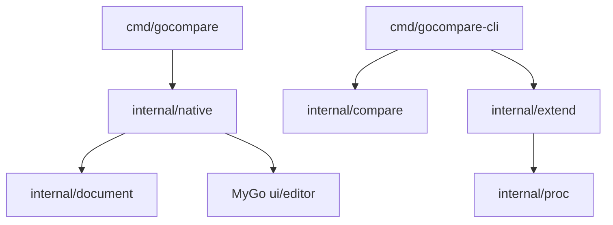

# 架构与数据流

日期：2026-10-31。状态：基础实现，持续演进。

## 依赖边界

`cmd` 只处理进程入口；`document` 不依赖 UI，管理文件信息与保存契约；`compare` 不依赖窗口，实现无界面可调用用例；`native` 持有控件、编辑缓冲区及窗口状态。`extend` 通过 `proc` 启动外部进程。

## 当前模型

- `document.File`：绝对路径、规范化 LF 文本、编码、BOM、原始换行、摘要与文件身份。文件比较用 `ReadDetected`：UTF-16 BOM、合法 UTF-8，或能原样往返的 GBK。Latin-1 仍要显式指定。超过 16 MiB 拒绝。
- `native.pane`：一个文件基线、一个 MyGo Buffer 和一个编辑器状态。
- `native.workspace`：左右面板、比较视图、编辑模式、异步任务、错误与待确认操作。
- `compare.EqualFiles`：流式比较原始字节，按块检查取消，错误独立返回。

加载和保存工作在后台，完成后通过 `Window.Update` 发布；测试无窗口时同步执行相同逻辑。每个工作区只允许一个 I/O 任务，任务执行期间禁止重载、应用差异和编辑。关窗取消任务。控件只持久化状态，不能存储 `ui.Element` 或在后台捕获 Context。

## 保存契约

读取时保留原始摘要、身份和权限。保存检查基线，编码为原始 BOM／换行，写入同目录临时文件、设置权限、同步并关闭，再次核对基线，最后重命名替换。外部修改返回 `ErrChanged`，错误不会清除修改状态。

这是乐观并发检查，最后核对与替换之间仍存在竞争窗口。新建文件优先用同目录硬链接发布；exFAT、FAT32 等不支持硬链接时退回 `O_EXCL` 排他创建，仍不覆盖已有文件，但写入期间目标可能短暂不完整。「忽略空行」只把比较视图换成去除空行的只读副本，不改写用户缓冲区。目录持久化、ACL、扩展属性、硬链接和不同平台替换语义需在文件操作层继续实现；当前不能用该保存用例宣称批量同步具有事务性。

## P0 尚未解决的框架边界

MyGo v0.7.3 的 `DiffView` 左侧固定只读，视图中的 `ensure` 会更新差异模型。当前通过受控的 `OldEditable` 与 `ExternalComparison` 补丁开放分栏左侧编辑，并把差异重算移出绘制路径。结果带回 UI 线程前会核对缓冲区身份和版本。已实现同屏双侧编辑、当前焦点侧保存、I/O 期间双侧锁定，以及可取消的后台比较。手工锚点由 `textcompare` 计算，再经 `ApplyHunks` 显示；逆序锚点拒绝且不替换当前差异。下一步验证多栏行映射和真实输入法。

应用核心不能导入 MyGo 的 `internal/*`。框架依赖以标准 vendor 快照保存，仅对 DiffState 的公开选项与只读判断作小范围修改；补丁单独保存在 patches/，尚未创建远程 fork。维护步骤见 mygo-patch.md。

## 后续模型

- `Location` 与能力接口：来源 ID、原始路径、容器层级；凭据只保存引用。
- `CompareResult`：输入和规则版本、重要性、差异范围、完成状态。
- `Alignment`：逻辑行映射、占位、人工锚点；不同于屏幕行布局。
- `MergeConflict`：基准／左右范围、决策、输出锚点。
- `OperationPlan`：操作方向、前置版本、依赖、执行与恢复结果。

只在相应功能进入实现阶段时引入这些类型。目录、合并、远程操作继续使用相同应用用例，GUI 与 CLI 共用行为。

## 保存、会话和目录操作增量

新增 `workspace` 管理版本化可移植会话；`document.SaveAs` 采用不覆盖发布，`Backup` 备份原始字节。原生窗口状态更名为 `workspaceState`，与持久化包名称区分。

`compare.Directories` 递归输出按相对路径排序的配对，保留读取错误，默认不跟随链接。显式 `LinkFollow` 才会跟随，逃出根或成环时失败。`ScanOptions` 可按进度回调先交出父目录。`operations.Preview` 生成带 SHA-256、文件类型和时间戳前置条件的操作计划；`Execute` 先全量核对，再逐项检查，覆盖／删除前备份。执行中途失败时按相反顺序回滚已经生效的操作；回滚失败会留下仍生效的前缀和错误。`Restore` 可对成功执行的日志做同样的撤销，但拒绝覆盖执行后被重新创建的路径；复制类操作只在目标内容仍等于同步写入的内容（大小与 SHA-256）时才撤销，之后被修改过的文件不会被覆盖或删除。`Preview` 发现扫描时不存在、磁盘上却已存在的目标（只差大小写或 Unicode 规范化的名字）时拒绝生成计划。`ExecutePauseBefore` 在指定动作前停下且不回滚，`Resume` 从同一日志继续。该协议不提供跨进程 CAS。备份位于备份目录下的固定 `sync` 子目录。

`merge` 提供两方和三方行级文本合并，每行连同换行符一起比较，文件末尾有无换行也参与合并与冲突。GUI 只覆盖本窗口上次写出的合并输出。没有祖先时，不同区域都是冲突；有祖先时，单侧修改自动采用，两侧不同修改保留基准、左侧和右侧。决策通过 `Take` 作用于结构化结果，不从冲突标记反解析。不超过 4000 行时沿用原有行对齐；超过后改用 Myers，单份输入超过 100000 行时拒绝计算。`Alignments` 按行给出基准、左侧和右侧原文：未改区域三列相同，单侧修改保留未改一侧，较短的一侧没有对应行。`Take` 只替换输出，不改这些原文。两方合并没有基准列。

原生层通过单个后台 I/O 任务串行调用；文件列表使用稳定路径键和虚拟列表。三方合并在同一工作区用虚拟列表把基准、左侧和右侧放在同一行里滚动，输出编辑器仍在下方。主窗口的「打开合并窗口」另建一份只含合并的窗口状态，不切换当前比较；应用已就绪时才调用 `NewWindow`。CLI 与 GUI 使用相同目录、合并与操作核心。PNG、JPEG 和 GIF 由 `picture.Open` 解码后再做像素比较。工作区的「图片比较」不走文本安装：加载完成后先按左右两侧各自的翻转开关处理图片，再按并排、叠加、差值、容差或替换颜色生成位图，并用 `ui.Bitmap` 的 Pixelated 画到「图片画布」。切换模式或容差时在后台重算，计算期间的新请求合并为一次补算；差异统计随位图缓存，绘制时不扫描像素。适应窗口交给 `ui.Image` 的 Fit 按可用区域缩放。GIF 只显示第一帧，不播放后续帧。工作区的「媒体标签」同样不走文本安装：后台读取两侧 ID3v2 的 `TIT2`、`TPE1` 和 `TALB`，只展示这些文本并标明不能播放。时间推进不改变标签，也不解码音频。`extend` 用版本 1 的 JSON 规格启动外部进程：`compare` 把退出码 0 和 1 当成相同与不同，`convert` 取标准输出，`compress` 读取 `%out` 文件。占位符必须独占一个参数，不经过 shell。失败、超限和取消都不把部分输出当成成功。工作区「目录比较」和 CLI `dir` 把过滤、权限、修改时间和链接策略传给 `CompareDirectories`。扫描顺序只在界面线程追加，父目录早于子项；默认只记录链接，跟随才会检查是否逃出根。应用图标来自嵌入的 PNG，顶栏显示构建信息中的 MyGo 版本。`Run` 在创建窗口前调用 `Dock.SetIcon`；图标设置失败则退出，不打开窗口。工作区「版本与注册表」和 CLI 的 `pe`、`reg` 只读文件：两侧都是注册表 5.00 文本时列出不同的键，否则读取 PE 资源里的 `FileVersion`。这一路不访问实时注册表。
