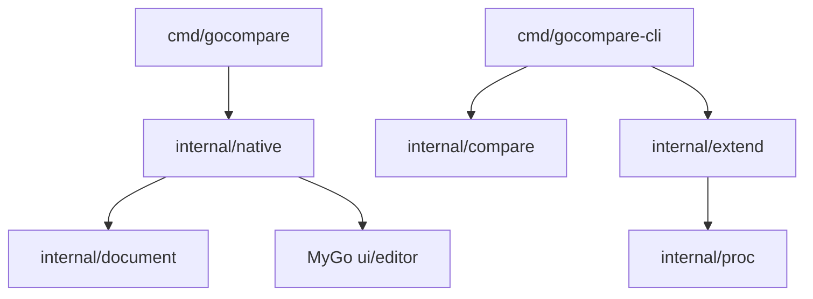

# 架构与数据流

日期：2026-10-31。状态：基础实现，持续演进。

## 依赖边界

`cmd` 只处理进程入口；`document` 不依赖 UI，管理文件信息与保存契约；`compare` 不依赖窗口，实现无界面可调用用例；`native` 持有控件、编辑缓冲区及窗口状态。`extend` 通过 `proc` 启动外部进程。

## 当前模型

- `document.File`：绝对路径、规范化 LF 文本、编码、BOM、原始换行、摘要与文件身份。文件比较用 `ReadDetected`：UTF-16 BOM、合法 UTF-8，或能原样往返的 GBK。Latin-1 仍要显式指定。超过 16 MiB 拒绝。
- `native.pane`：一个文件基线、一个 MyGo Buffer 和一个编辑器状态。
- `native.workspace`：左右面板、比较视图、编辑模式、异步任务、错误与待确认操作。
- `compare.EqualFiles`：流式比较原始字节，按块检查取消，错误独立返回。

加载和保存工作在后台，完成后通过 `Window.Update` 发布；测试无窗口时同步执行相同逻辑。每个工作区只允许一个 I/O 任务，任务执行期间禁止重载、应用差异和编辑。关窗取消任务。控件只持久化状态，不能存储 `ui.Element` 或在后台捕获 Context。

## 保存契约

读取时保留原始摘要、身份和权限。保存检查基线，编码为原始 BOM／换行，写入同目录临时文件、设置权限、同步并关闭，再次核对基线，最后重命名替换。外部修改返回 `ErrChanged`，错误不会清除修改状态。

这是乐观并发检查，最后核对与替换之间仍存在竞争窗口。新建文件优先用同目录硬链接发布；exFAT、FAT32 等不支持硬链接时退回 `O_EXCL` 排他创建，仍不覆盖已有文件，但写入期间目标可能短暂不完整。「忽略空行」只把比较视图换成去除空行的只读副本，不改写用户缓冲区。目录持久化、ACL、扩展属性、硬链接和不同平台替换语义需在文件操作层继续实现；当前不能用该保存用例宣称批量同步具有事务性。

## P0 尚未解决的框架边界

MyGo v0.7.3 的 `DiffView` 左侧固定只读，视图中的 `ensure` 会更新差异模型。当前通过受控的 `OldEditable` 与 `ExternalComparison` 补丁开放分栏左侧编辑，并把差异重算移出绘制路径。结果带回 UI 线程前会核对缓冲区身份和版本。已实现同屏双侧编辑、当前焦点侧保存、I/O 期间双侧锁定，以及可取消的后台比较。手工锚点由 `textcompare` 计算，再经 `ApplyHunks` 显示；逆序锚点拒绝且不替换当前差异。下一步验证多栏行映射和真实输入法。

应用核心不能导入 MyGo 的 `internal/*`。框架依赖以标准 vendor 快照保存，仅对 DiffState 的公开选项与只读判断作小范围修改；补丁单独保存在 patches/，尚未创建远程 fork。维护步骤见 mygo-patch.md。

## 后续模型

- `Location` 与能力接口：来源 ID、原始路径、容器层级；凭据只保存引用。
- `CompareResult`：输入和规则版本、重要性、差异范围、完成状态。
- `Alignment`：逻辑行映射、占位、人工锚点；不同于屏幕行布局。
- `MergeConflict`：基准／左右范围、决策、输出锚点。
- `OperationPlan`：操作方向、前置版本、依赖、执行与恢复结果。

只在相应功能进入实现阶段时引入这些类型。目录、合并、远程操作继续使用相同应用用例，GUI 与 CLI 共用行为。

## 保存、会话和目录操作增量

新增 `workspace` 管理版本化可移植会话；`document.SaveAs` 采用不覆盖发布，`Backup` 备份原始字节。原生窗口状态更名为 `workspaceState`，与持久化包名称区分。

`compare.Directories` 递归输出按相对路径排序的配对，保留读取错误，默认不跟随链接。显式 `LinkFollow` 才会跟随，逃出根或成环时失败。`ScanOptions` 可按进度回调先交出父目录。`operations.Preview` 生成带 SHA-256、文件类型和时间戳前置条件的操作计划；`Execute` 先全量核对，再逐项检查，覆盖／删除前备份。执行中途失败时按相反顺序回滚已经生效的操作；回滚失败会留下仍生效的前缀和错误。`Restore` 可对成功执行的日志做同样的撤销，但拒绝覆盖执行后被重新创建的路径；复制类操作只在目标内容仍等于同步写入的内容（大小与 SHA-256）时才撤销，之后被修改过的文件不会被覆盖或删除。`Preview` 发现扫描时不存在、磁盘上却已存在的目标（只差大小写或 Unicode 规范化的名字）时拒绝生成计划。`ExecutePauseBefore` 在指定动作前停下且不回滚，`Resume` 从同一日志继续。该协议不提供跨进程 CAS。备份位于备份目录下的固定 `sync` 子目录。

`merge` 提供两方和三方行级文本合并，每行连同换行符一起比较，文件末尾有无换行也参与合并与冲突。GUI 只覆盖本窗口上次写出的合并输出。没有祖先时，不同区域都是冲突；有祖先时，单侧修改自动采用，两侧不同修改保留基准、左侧和右侧。决策通过 `Take` 作用于结构化结果，不从冲突标记反解析。不超过 4000 行时沿用原有行对齐；超过后改用 Myers，单份输入超过 100000 行时拒绝计算。`Alignments` 按行给出基准、左侧和右侧原文：未改区域三列相同，单侧修改保留未改一侧，较短的一侧没有对应行。`Take` 只替换输出，不改这些原文。两方合并没有基准列。

原生层通过单个后台 I/O 任务串行调用；文件列表使用稳定路径键和虚拟列表。三方合并在同一工作区用虚拟列表把基准、左侧和右侧放在同一行里滚动，输出编辑器仍在下方。主窗口的「打开合并窗口」另建一份只含合并的窗口状态，不切换当前比较；应用已就绪时才调用 `NewWindow`。CLI 与 GUI 使用相同目录、合并与操作核心。PNG、JPEG 和 GIF 由 `picture.Open` 解码后再做像素比较。工作区的「图片比较」不走文本安装：加载完成后先按左右两侧各自的翻转开关处理图片，再按并排、叠加、差值、容差或替换颜色生成位图，并用 `ui.Bitmap` 的 Pixelated 画到「图片画布」。切换模式或容差时在后台重算，计算期间的新请求合并为一次补算；差异统计随位图缓存，绘制时不扫描像素。适应窗口交给 `ui.Image` 的 Fit 按可用区域缩放。GIF 只显示第一帧，不播放后续帧。工作区的「媒体标签」同样不走文本安装：后台读取两侧 ID3v2 的 `TIT2`、`TPE1` 和 `TALB`，只展示这些文本并标明不能播放。时间推进不改变标签，也不解码音频。`extend` 用版本 1 的 JSON 规格启动外部进程：`compare` 把退出码 0 和 1 当成相同与不同，`convert` 取标准输出，`compress` 读取 `%out` 文件。占位符必须独占一个参数，不经过 shell。失败、超限和取消都不把部分输出当成成功。工作区「目录比较」和 CLI `dir` 把过滤、权限、修改时间和链接策略传给 `CompareDirectories`。扫描顺序只在界面线程追加，父目录早于子项；默认只记录链接，跟随才会检查是否逃出根。应用图标来自嵌入的 PNG，顶栏显示构建信息中的 MyGo 版本。`Run` 在创建窗口前调用 `Dock.SetIcon`；图标设置失败则退出，不打开窗口。工作区「版本与注册表」和 CLI 的 `pe`、`reg` 只读文件：两侧都是注册表 5.00 文本时列出不同的键，否则读取 PE 资源里的 `FileVersion`。这一路不访问实时注册表。

## 表格、远程、压缩包、快照与文档转换

- `table`：解析 CSV、TSV、Excel (.xlsx) 工作表与 HTML `<table>` 节点，支持复合主键对齐、列映射和浮点数容差比较；CLI `table` 通过 `--keys`、`--map`、`--tolerance` 暴露这些选项，GUI `kindTable`「表格比较」模式按行号对齐呈现单元格级差异。
- `remote`：实现 `Store` 抽象，覆盖 FTP、FTPS、SFTP、SMB2/3、WebDAV、S3 (AWS SigV4)、Dropbox、OneDrive 与 SVN HTTP 子集。SFTP 基于 `golang.org/x/crypto/ssh` 与 `github.com/pkg/sftp`，主机密钥必须已在 known_hosts 登记（不自动信任首次连接），认证依次使用 URL 密码、ssh-agent、私钥文件；SMB 基于 `github.com/hirochachacha/go-smb2`，使用 NTLMv2，协议版本、签名与加密由服务端协商。`webdav+https`、`s3+https`、`svn+https` 走 HTTPS。CLI `remote [--timeout] [--known-hosts] [--identity]` 提供 read、write、delete 与 compare 操作。
  - GUI 文件比较路径栏的「远程…」按钮打开连接对话框（`native/remote_dialog.go`）：协议、主机、端口、用户、密码、SMB 域与共享、SFTP 私钥及私钥口令；所有字段可手动填写，`~/.ssh/config`（`remote.LoadSSHConfig`）只作为可选导入。SFTP 认证顺序为指定私钥 → 密码 → ssh-agent → 默认私钥；受口令保护的私钥缺口令或口令错误分别返回 `remote.ErrKeyPassphrase`、`ErrKeyPassphraseWrong`，界面据此提示或询问。CLI 从环境变量 `GOCOMPARE_SSH_KEY_PASSPHRASE` 读取私钥口令。主机密钥算法按 known_hosts 中该主机已登记的密钥类型协商（`knownAlgorithms`，与 OpenSSH 一致），避免服务端同时提供 ed25519 与 ECDSA 时误判为密钥不一致；真正不一致返回 `remote.ErrHostKeyChanged`。连接后经 `remote.Lister` 浏览目录（SFTP、SMB 含共享列表、FTP 的 MLSD、WebDAV 的 PROPFIND；不支持时改为手动输入路径），选中文件后由 `remote.Endpoint.URL` 生成地址填入路径框。最近连接（不含密码）保存在用户配置目录的 `GoCompare/remotes.json`，权限 0600。
  - 目录比较：`compare.Source` 抽象比较的一侧，`LocalSource` 包装原有扫描，`RemoteSource` 基于 `remote.Conn` 递归列目录、按需读文件，两者共用 `CompareSources` 的对齐、过滤与汇总逻辑。`remote.Connect` 让 SFTP、SMB 在整个扫描期间复用一条连接（其他协议逐次请求）；远程扫描不跟随符号链接。目录模式的「远程…」对话框改为选择目录；同步、目录合并与撤销只支持本地目录，任一侧为远程时禁用。从结果打开文件用 `remote.JoinPath` 拼出远程地址；远程缺失的一侧用 `document.EmptyRemote` 建立空缓冲区，保存时要求远程仍不存在再创建。
  - 路径框也直接接受远程地址：`native/remote.go` 经 `document.ReadRemote` 读取，保存时 `File.Save` 重新读取远程内容核对基线后写回（无比较并交换语义，存在短暂竞争窗口）。服务端返回 `remote.ErrAuth` 时弹出密码框，密码只存于进程内存；`remote.HostKeyError` 弹出指纹确认，信任后追加到 known_hosts（文件不存在时创建）。URL 中的密码在加载前移出路径框，不进入标题和会话。单次远程读写超时 2 分钟。
- `archive`：支持 zip（读写与 Deflate/Store 压缩）、tar.gz（只读）与 7z（明确拒绝）；CLI `archive` 提供 list、compare 与 pack 跨归档差异对比与打包。
- `snapshot`：带有 `GOCMPSNP` 头部的无内容目录快照，序列化记录路径、是否目录与文件大小；支持扫描目录构建快照并在脱机环境下进行结构与文件大小对比。
- `doctext`：将 Word (.docx)、RTF 与 PDF 文档提取为纯文本；PDF 只取内容流（含 FlateDecode）中 Tj/TJ/'/" 操作符的字符串，跳过字体、图片、XRef 等非内容流。`document.ReadDetected` 自动把 docx、PDF 转为只读文本参与比较，RTF 保持按源码编辑；合并入口（CLI、GUI、脚本）通过 `document.ReadMergeable` 拒绝转换文档。
- `dirmerge`：提供两方与三方目录合并决策引擎，自动对齐相对路径并结合文本冲突检测（Myers/三方对齐），支持合并结果安全写出至独立输出目录；二进制与删除/修改冲突写成 `<path>.left`、`<path>.right`，不生成占位内容；单棵目录树读入上限 256 MiB。GUI 目录工具栏提供「目录合并」预览面板与冲突徽标指示。
- `updater`：实现版本对比与在线更新检测，支持 GitHub Release 查询、含预发布版的 SemVer 比较及按整词匹配的平台资产选择（区分桌面应用与 CLI 产物，跳过校验和、签名文件），下载地址只接受 https；CLI `check-update` 与 Native 设置弹窗「检查更新」提供更新提示，GUI 检查独立于工作区任务运行。
- `acl`：在 Unix 读取权限位、属主与属组并比较，每项差异只报告一次；Windows 明确返回不支持。CLI `acl` 子命令输出差异。

### 比较输入与写入边界

- 文档转换不可逆：`document.File.ReadOnly()` 标识转换结果，编辑器只读，保存接口拒绝写入；普通文本仍保留原有保存行为。
- 目录合并只接受空输出目录，通过 `os.Root` 限制写入范围并排他创建文件，拒绝已有内容及目标目录符号链接。
- Excel 按行列坐标恢复稀疏单元格；HTML 使用锁定版本 `golang.org/x/net/html` 解析嵌套文本和实体。
- HTTP、FTP 远程读取与原生表格输入、xlsx 单个部件超过 32 MiB 明确失败，不返回截断内容；SFTP、SMB 读取同样受 32 MiB 上限约束，写入会截断已有文件。
- FTP 数据连接只采用 PASV 返回的端口，主机沿用控制连接对端；路径与凭据中的 CR/LF 被拒绝。
- 快照解码先验证节点数量与输入长度一致，再分配内存。
- FTPS URL 使用主机名校验证书；SFTP 遇到未知或变化的主机密钥直接拒绝并给出 SHA256 指纹；Windows ACL 尚未读取安全描述符，明确返回不支持。
- CLI `archive pack`、`snapshot create` 以排他方式创建输出文件，目标已存在时报错。
